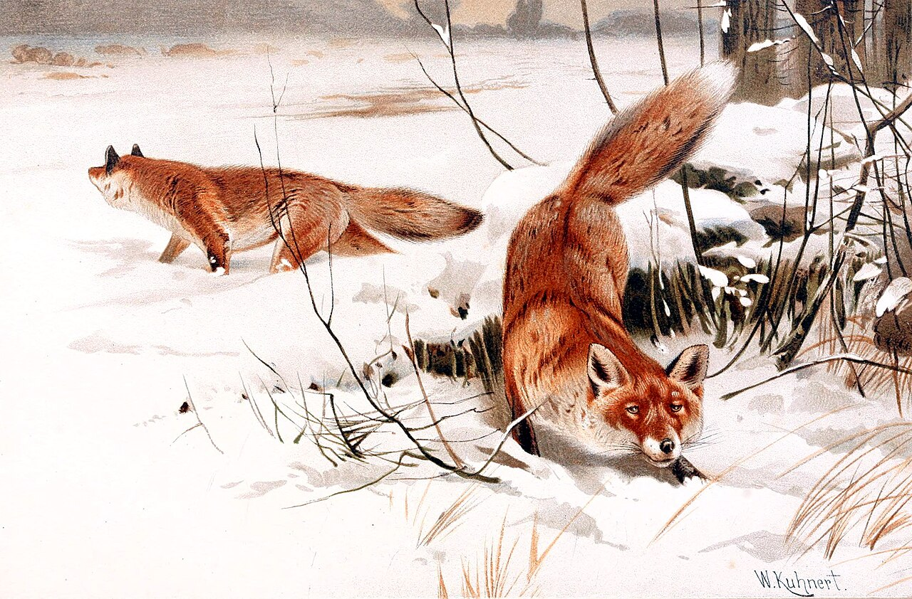
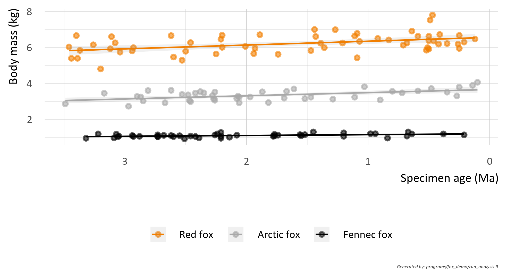
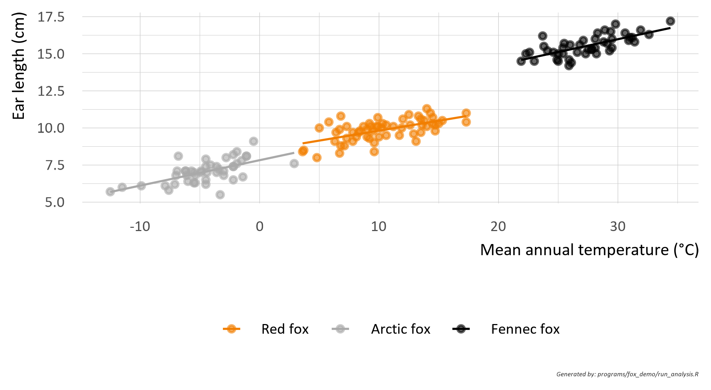
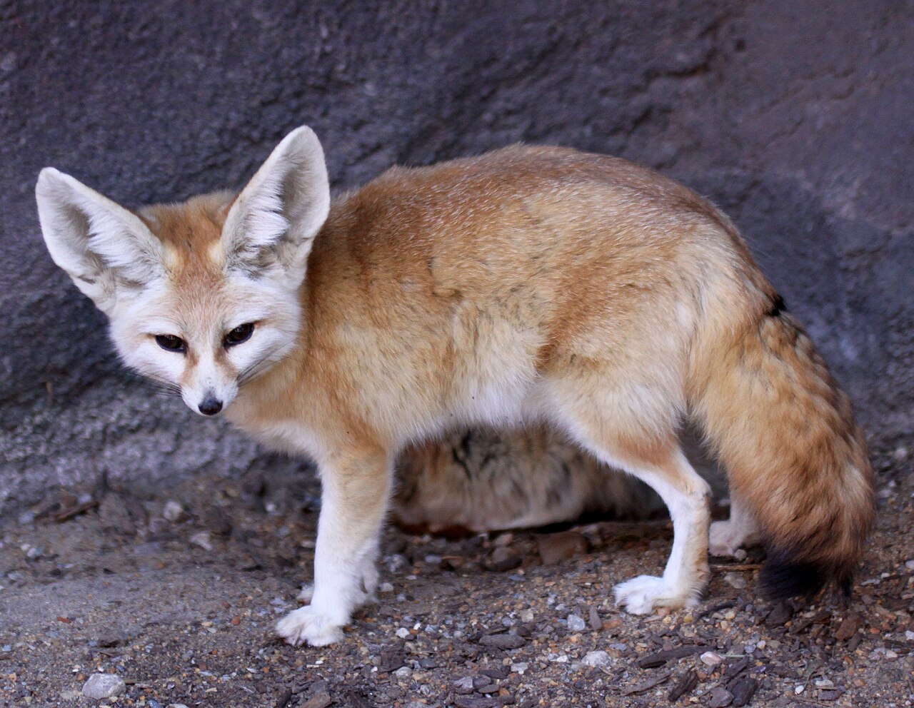
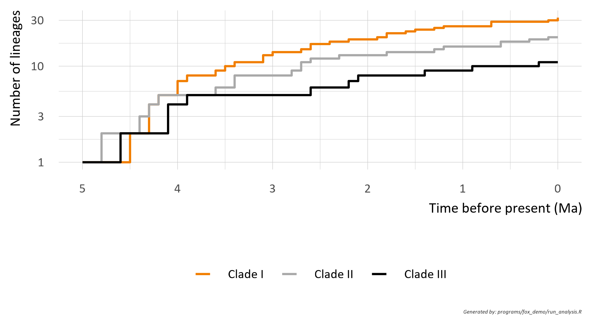
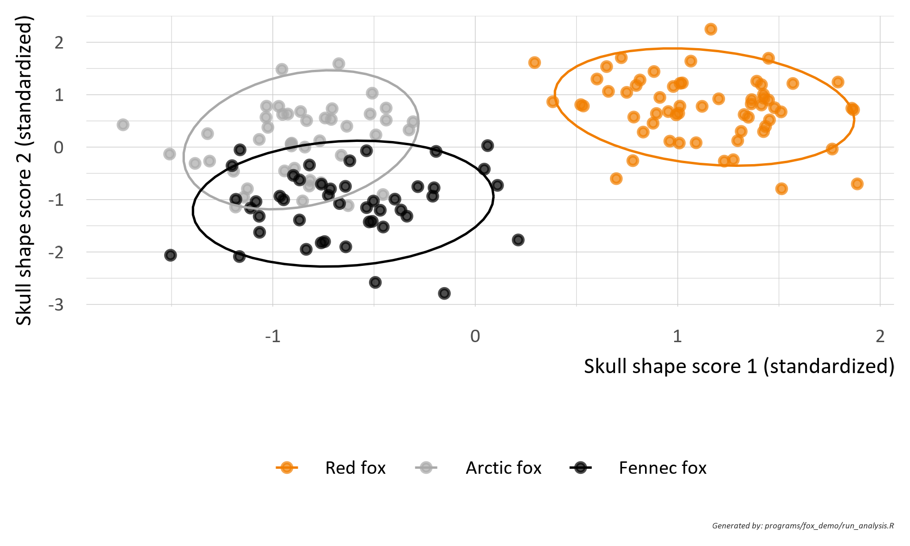
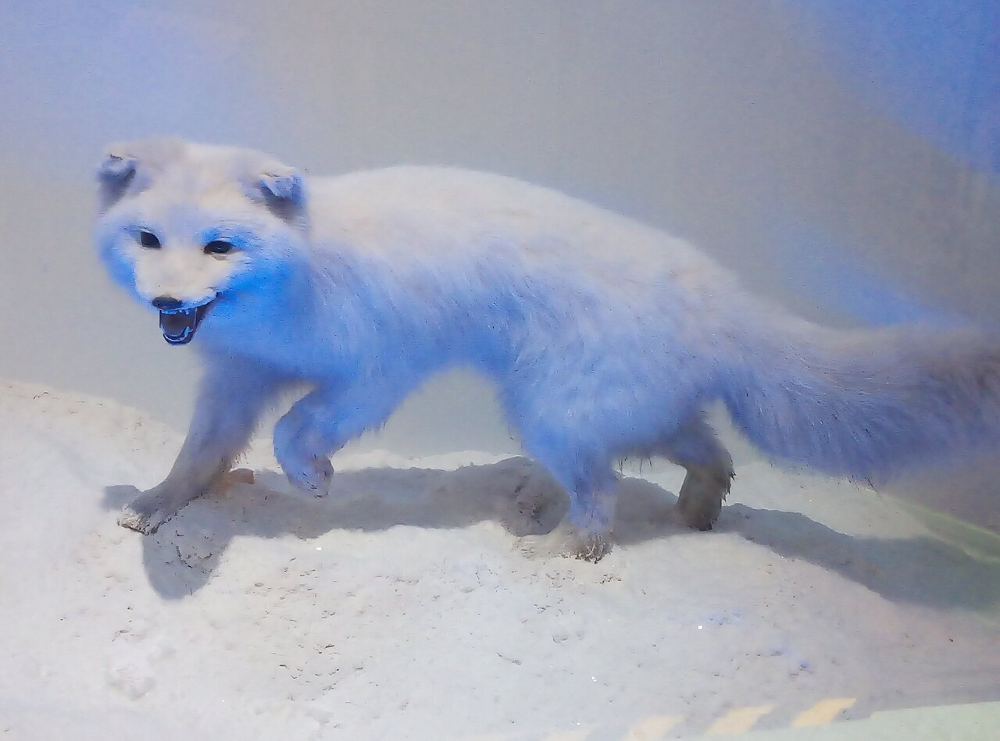
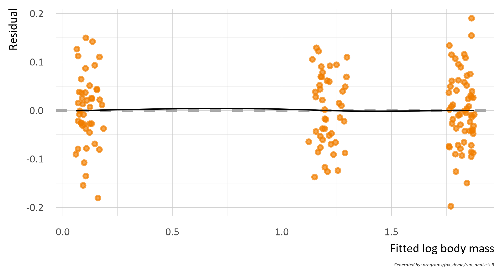

```{r}
#| label: libraries
#| echo: false
#| warning: false
#| message: false

library(tidyverse)
library(gt)
library(here)

here::i_am("reports/fox_demo/fox_demo.qmd")

set.seed(2026)

source(here::here("setup/sysfont_module.R"))
source(here::here("R/gt_table.R"))
source(here::here("R/render_helpers.R"))
```

```{r}
#| label: load-data
#| echo: false
#| warning: false
#| message: false

# Fictional data simulated by programs/fox_demo/run_analysis.R; the report only
# reads them.
fox <- readRDS(here::here("output/fox_demo/_cache/fox_data.rds"))
specimens <- fox$specimens

# Inline numbers for the text
.n_total <- nrow(specimens)
.n_sites <- n_distinct(specimens$site)
.mass_pct <- (exp(fox$coef_mass$estimate[fox$coef_mass$term == "age_ma"]) - 1) *
  100
.ear_slope <- fox$coef_ear$estimate[fox$coef_ear$term == "temp_c"]

# Coefficient table shared by the two model appendices
.coef_gt <- function(coefs, x_label) {
  coefs |>
    mutate(
      term = case_when(
        term == "(Intercept)" ~ "Intercept (Red fox)",
        term %in% c("age_ma", "temp_c") ~ paste0(x_label, " (Red fox)"),
        str_detect(term, ":") ~ paste0(
          x_label,
          " × ",
          str_remove(term, "^.*:common")
        ),
        TRUE ~ paste0(str_remove(term, "^common"), " (offset)")
      )
    ) |>
    celon_gt() |>
    cols_label(
      term = "Term",
      estimate = "Estimate",
      se = "Std. error",
      t = "t value",
      p = "p value"
    ) |>
    fmt_number(c(estimate, se, t), decimals = 3) |>
    fmt(
      p,
      fns = \(x) ifelse(x < 1e-4, "<0.0001", formatC(x, format = "f", digits = 4))
    ) |>
    bold_headers()
}
```

```{r}
#| label: draft-banner
#| echo: false
#| results: asis

draft_banner(params$is_draft, params$version)
```

::: {.callout-warning icon=false}

## **Demonstration document**

This report exists only to showcase the report format (title page, headers,
numbering, cross-references, landscape pages, appendices, bibliography). All
data are **simulated**, all references are **fictitious**, and no result has
any scientific meaning. Photographs are taken from Wikimedia Commons under the
licenses stated in the captions.

:::

# Summary {#sec-summary}

Three fox species (red, Arctic and fennec fox) were compared on simulated
morphometric data from `r .n_total` specimens collected at `r .n_sites`
sites and spanning the last 3.5 million years (Ma). Body mass changed by
`r sprintf("%+.1f", .mass_pct)`% per million years of specimen age in the red
fox, and ear length increased by `r sprintf("%.2f", .ear_slope)` cm per °C of
mean annual temperature (@sec-results). Lineage accumulation differed between
three fictional clades (@fig-ltt). The description is exploratory and
purely illustrative.

# Introduction {#sec-introduction}

## Background {#sec-background}

Foxes are small to medium-sized members of the family Canidae and occupy
habitats from Arctic tundra to hot desert [@Reynard2019]. Their appendages
are a textbook illustration of adaptation to ambient temperature: large ears
in the fennec fox dissipate heat, whereas the compact ears of the Arctic fox
conserve it [@Vulpine2021]. @fig-painting shows a historical painting of
common foxes in a winter landscape.

{#fig-painting fig-pos="H" width=55%}

## Objectives {#sec-objectives}

The objectives of this demonstration analysis were to

1. describe the change of body mass over geological time,
2. relate ear length to mean annual temperature, and
3. compare the accumulation of lineages between clades.

# Methods {#sec-methods}

## Specimens and data sources {#sec-data}

Specimen records were simulated for three species (@tbl-species). Each record
holds the site, the specimen age, the mean annual temperature at the site
and time of deposition, and five morphometric measurements^[Body mass, ear
length, skull length, tail length and hind foot length.]. Sampling bias is a
known problem of fossil data [@Tod2015] and is ignored here.

```{r}
#| label: tbl-species
#| echo: false
#| tbl-cap: "Simulated specimens by species: number of specimens, age range, and mean (SD) of body mass and ear length."
#| tbl-pos: "H"

specimens |>
  summarise(
    n = n(),
    age = sprintf("%.1f–%.1f", min(age_ma), max(age_ma)),
    mass = sprintf("%.2f (%.2f)", mean(body_mass_kg), sd(body_mass_kg)),
    ear = sprintf("%.1f (%.1f)", mean(ear_cm), sd(ear_cm)),
    .by = c(common, species, habitat)
  ) |>
  mutate(species = paste0("*", species, "*")) |>
  celon_gt() |>
  fmt_markdown(species) |>
  cols_label(
    common = "Common name",
    species = "Species",
    habitat = "Habitat",
    n = "N",
    age = "Age range (Ma)",
    mass = "Body mass (kg)",
    ear = "Ear length (cm)"
  ) |>
  cols_align("center", c(n, age, mass, ear)) |>
  tab_footnote("Values are arithmetic mean (standard deviation).") |>
  bold_headers()
```

## Statistical analysis {#sec-statistics}

Body mass $m$ of specimen $j$ of species $s$ was modeled on the log scale as
a linear function of specimen age $t$,

$$
\log m_{sj} = \beta_{0,s} + \beta_{1,s}\, t_{sj} + \varepsilon_{sj},
\qquad \varepsilon_{sj} \sim N(0, \sigma^2),
$$ {#eq-mass}

and ear length was modeled analogously on mean annual temperature. Both
models contain a species-specific intercept and slope (details in
@sec-appendix-1). Lineages through time were simulated as a pure-birth
process [@Kitsune2023]. Skull shape scores were derived as described by
@Brush2017.

::: {.callout-note icon=false}

All p-values are descriptive. No hypothesis was specified in advance, so no
multiplicity adjustment was made.

:::

# Results {#sec-results}

## Body mass through time {#sec-res-mass}

Body mass was highest in the red fox and lowest in the fennec fox, with a
slight increase towards the present in all three species (@fig-mass). On the
log scale the red fox slope was
`r sprintf("%.3f", fox$coef_mass$estimate[fox$coef_mass$term == "age_ma"])`
per million years (@tbl-coef-mass).

{#fig-mass fig-pos="H" width=85%}

## Ear size and climate {#sec-res-ear}

Ear length increased with mean annual temperature in every species
(@fig-ear), in line with the heat-dissipation argument of @Vulpine2021. The
fennec fox (@fig-fennec) had the longest ears at every temperature.

{#fig-ear fig-pos="H" width=85%}

{#fig-fennec fig-pos="H" width=40%}

## Diversification {#sec-res-div}

The three fictional clades accumulated lineages at different rates
(@fig-ltt). Clade I, the fastest, accumulated the most lineages, whereas
Clade III grew only modestly.

{#fig-ltt fig-pos="H" width=85%}

## Specimen-level data {#sec-res-listing}

@tbl-specimens lists a selection of specimens with all measurements. The
table occupies a full landscape page; the page orientation returns to
portrait after it.

\blandscape

```{r}
#| label: tbl-specimens
#| echo: false
#| tbl-cap: "Selection of simulated specimens (eight per species) with provenance, context and morphometric data."
#| tbl-pos: "p"

specimens |>
  arrange(common, specimen_id) |>
  slice_head(n = 8, by = common) |>
  select(
    common, specimen_id, site, region, latitude, age_ma, temp_c,
    body_mass_kg, ear_cm, skull_cm, tail_cm, hind_foot_cm, pc1, pc2
  ) |>
  celon_gt(groupname_col = "common") |>
  tab_spanner("Provenance", c(site, region, latitude)) |>
  tab_spanner("Context", c(age_ma, temp_c)) |>
  tab_spanner(
    "Morphometrics",
    c(body_mass_kg, ear_cm, skull_cm, tail_cm, hind_foot_cm)
  ) |>
  tab_spanner("Shape scores", c(pc1, pc2)) |>
  cols_label(
    specimen_id = "Specimen",
    site = "Site",
    region = "Region",
    latitude = "Latitude (°N)",
    age_ma = "Age (Ma)",
    temp_c = "Temp. (°C)",
    body_mass_kg = "Body mass (kg)",
    ear_cm = "Ear (cm)",
    skull_cm = "Skull (cm)",
    tail_cm = "Tail (cm)",
    hind_foot_cm = "Hind foot (cm)",
    pc1 = "Score 1",
    pc2 = "Score 2"
  ) |>
  fmt_number(c(age_ma, body_mass_kg, pc1, pc2), decimals = 2) |>
  fmt_number(c(temp_c, ear_cm, skull_cm, tail_cm, hind_foot_cm), decimals = 1) |>
  cols_align("center", -c(specimen_id, site, region)) |>
  tab_footnote(
    "Skull shape scores are standardized (mean 0, SD 1) over all specimens."
  ) |>
  tab_options(table.font.size = gt::px(12), table.width = gt::pct(100)) |>
  bold_headers()
```

\elandscape

# Discussion {#sec-discussion}

The simulated data reproduce the qualitative pattern expected from the
literature: larger bodies in the temperate species, and longer ears in warmer
climates. The effect sizes carry no information because the data were
generated from the same equations that were used to analyze them.

## Limitations {#sec-limitations}

- The data are fictional.
- Specimen age was drawn independently of site, so no spatial structure exists.
- The lineage process ignores extinction.

# Conclusions {#sec-conclusions}

This document demonstrates numbered sections and subsections, cross-references
to figures, tables, equations and appendices, a landscape page, separately
numbered appendices, a bibliography and tables of contents, tables and
figures.

\newpage

# References {#sec-references}

::: {#refs}
:::

\newpage

\tableofcontents

\newpage

\listoftables

\listoffigures


<!-- Appendix numbering (PDF only; see appendix-numbering.md). Keep this block
     before any \blandscape: TeX groups swallow the \renewcommand calls. -->

\newpage

```{=latex}
\appendix
  \renewcommand{\thesection}{A\arabic{section}}
  \counterwithin{table}{section}
  \renewcommand{\thetable}{\thesection-\arabic{table}}
  \counterwithin{figure}{section}
  \renewcommand{\thefigure}{\thesection-\arabic{figure}}
```

# Appendix 1 - Model details {#sec-appendix-1}

This appendix gives the coefficients of the two linear models of
@sec-statistics. Tables and figures are numbered per appendix.

## Body mass model {#sec-app-mass}

```{r}
#| label: tbl-coef-mass
#| echo: false
#| tbl-cap: "Coefficients of the log body mass model (@eq-mass). Reference species: red fox."
#| tbl-pos: "H"

.coef_gt(fox$coef_mass, "Age")
```

## Ear length model {#sec-app-ear}

```{r}
#| label: tbl-coef-ear
#| echo: false
#| tbl-cap: "Coefficients of the ear length model on mean annual temperature. Reference species: red fox."
#| tbl-pos: "H"

.coef_gt(fox$coef_ear, "Temperature")
```

## Skull shape {#sec-app-skull}

Skull shape scores separated the species along the first axis (@fig-skull).

{#fig-skull fig-pos="H" width=85%}

\newpage

# Appendix 2 - Sampling and diagnostics {#sec-appendix-2}

## Sampling sites {#sec-app-sites}

Specimens came from the sites listed in @tbl-sites. @fig-museum shows a
museum specimen of the Arctic fox.

```{r}
#| label: tbl-sites
#| echo: false
#| tbl-cap: "Number of simulated specimens by site and species."
#| tbl-pos: "H"

specimens |>
  count(site, region, latitude, common) |>
  pivot_wider(names_from = common, values_from = n, values_fill = 0) |>
  mutate(Total = `Red fox` + `Arctic fox` + `Fennec fox`) |>
  arrange(site) |>
  celon_gt() |>
  cols_label(site = "Site", region = "Region", latitude = "Latitude (°N)") |>
  cols_align("center", -c(site, region)) |>
  bold_headers()
```

{#fig-museum fig-pos="H" width=45%}

## Model diagnostics {#sec-app-diagnostics}

@fig-resid shows the residuals of the body mass model, and @tbl-agebins the
sample size and mean body mass per age class.

{#fig-resid fig-pos="H" width=85%}

```{r}
#| label: tbl-agebins
#| echo: false
#| tbl-cap: "Number of specimens and mean body mass (kg) by age class and species."
#| tbl-pos: "H"

specimens |>
  mutate(
    age_class = cut(
      age_ma,
      c(0, 1, 2, 3, 3.5),
      include.lowest = TRUE,
      labels = c("0–1", "1–2", "2–3", "3–3.5")
    )
  ) |>
  summarise(n = n(), mass = mean(body_mass_kg), .by = c(age_class, common)) |>
  pivot_wider(
    names_from = common,
    values_from = c(n, mass),
    names_glue = "{common}_{.value}"
  ) |>
  arrange(age_class) |>
  celon_gt() |>
  tab_spanner("Red fox", starts_with("Red fox")) |>
  tab_spanner("Arctic fox", starts_with("Arctic fox")) |>
  tab_spanner("Fennec fox", starts_with("Fennec fox")) |>
  cols_label(
    age_class = "Age class (Ma)",
    ends_with("_n") ~ "N",
    ends_with("_mass") ~ "Mean mass"
  ) |>
  fmt_number(ends_with("_mass"), decimals = 2) |>
  sub_missing() |>
  cols_align("center", -age_class) |>
  bold_headers()
```
